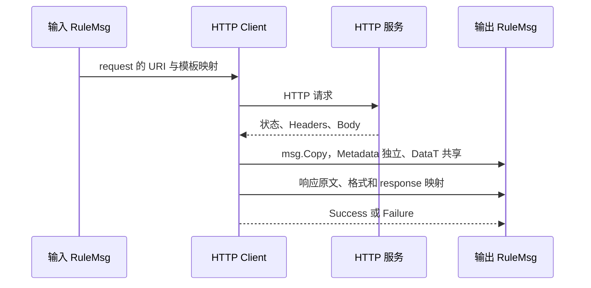

# HTTP 客户端使用指南

`external/httpClient` 从 `RuleMsg` 构建 HTTP 请求，再把响应写入输出消息。本文保留 Draft 状态，配置示例已按当前 `EndpointIOPacket` 实现校正；旧版 `from`、`params`、`mapping`、`defineSid` 不是当前配置字段。

## 1. 配置字段

| 字段 | 当前用途 |
| --- | --- |
| `defaultTimeout` | Go duration，例如 `10s`；缺省、不可解析或非正数时，当前请求 helper 使用 `60s`。 |
| `proxyUrl` | 可选 HTTP 代理地址。 |
| `request.url` / `request.method` | URL 与方法；支持 `${rulemsg://...}` 模板。固定 URL 和方法直接写字符串。 |
| `request.headers` / `request.queryParams` / `request.body` | 从消息读取数据的 `EndpointIOPacket`。 |
| `request.propagateMeta` / `request.propagateKeys` | 开启 trace metadata 传播，并可指定附加 metadata 键。 |
| `response.headers` / `response.body` | 将 HTTP 数据写回消息的 `EndpointIOPacket`。 |
| `response.statusCodeTarget` | 可选 metadata 键，存放 HTTP 状态码字符串。 |
| `response.latencyMsTarget` | 请求耗时毫秒；缺省键为 `httpLatencyMs`。 |
| `response.errorTarget` | 传输错误信息；缺省键为 `httpError`。 |
| `response.startTimeMsTarget` / `response.endTimeMsTarget` | 可选 metadata 键，存放 Unix 毫秒时间戳。 |

### EndpointIOPacket 的方向

- 请求 `mapAll` 是消息来源 URI，`fields[].bindPath` 是单字段来源 URI，`fields[].name` 是 HTTP 字段名。
- 响应 `mapAll` 是消息目标 URI，`fields[].name` 是 HTTP 字段名或 JSON 内部路径，`fields[].bindPath` 是消息目标 URI。
- `fields[].type` 可声明类型转换；`required` 和 `defaultValue` 处理字段缺失。请求常量使用空 `bindPath` 加 `defaultValue`，不能把带引号的字面量放进 `bindPath`。
- 同时配置 `mapAll` 与 `fields` 时，先执行整体映射，再补充或覆盖字段。

URI 读取需遵循[消息契约](../../reference/06_message_design_philosophy.md#5-消息-uri-访问契约)：`rulemsg://data/...` 显式指定 `format`，`rulemsg://dataT/...` 显式指定 `sid`。本页使用 Matrix 内置 `MapStringInterface`；业务对象应声明并注册自己的 SID。

## 2. POST JSON 并接收 JSON

输入 DataT 的 `userInfo` 对象使用 `MapStringInterface` 定义，内容为 `{"userId":123,"userName":"Alice"}`。

```json
{
  "id": "call-user-api",
  "type": "external/httpClient",
  "configuration": {
    "defaultTimeout": "10s",
    "request": {
      "url": "http://api.example.com/users/${rulemsg://dataT/userInfo.userId?sid=MapStringInterface}",
      "method": "POST",
      "body": {
        "mapAll": "rulemsg://dataT/userInfo?sid=MapStringInterface"
      }
    },
    "response": {
      "statusCodeTarget": "httpStatusCode",
      "body": {
        "mapAll": "rulemsg://dataT/apiResult?sid=MapStringInterface"
      }
    }
  }
}
```

请求路径变为 `/users/123`，对象序列化为 JSON，自动设置 `Content-Type: application/json`。响应声明 JSON Content-Type 时，JSON body 可映射到 `apiResult`；目标不存在时按已注册 SID 创建。响应原文也写入输出消息的 `Data`。

## 3. 查询参数与请求字段组合

GET 查询参数的配置片段：

```json
{
  "request": {
    "url": "http://api.example.com/items",
    "method": "GET",
    "queryParams": {
      "mapAll": "rulemsg://dataT/queryParams?sid=MapStringInterface"
    }
  }
}
```

当 `queryParams` 为 `{"page":1,"pageSize":10}`，请求查询参数为 `page=1&pageSize=10`。

请求体整体映射与单字段组合：

```json
{
  "body": {
    "mapAll": "rulemsg://dataT/baseInfo?sid=MapStringInterface",
    "fields": [
      {"name":"dynamic_field","bindPath":"rulemsg://metadata/dynamicId","type":"string"},
      {"name":"static_field","defaultValue":"static_value","type":"string"}
    ]
  }
}
```

输入 `baseInfo={"common":"value"}`、`metadata.dynamicId=xyz` 时，发送 `{"common":"value","dynamic_field":"xyz","static_field":"static_value"}`。当 body 没有映射且消息 Data 非空时，当前实现直接发送 Data，并按 DataFormat 设置 Content-Type。

## 4. 响应字段提取

响应为 `{"data":{"user":{"id":456}},"error_code":0}` 时：

```json
{
  "response": {
    "body": {
      "fields": [
        {"name":"data.user.id","bindPath":"rulemsg://metadata/extractedUserId","type":"string"},
        {"name":"error_code","bindPath":"rulemsg://dataT/apiResult.errorCode?sid=MapStringInterface","type":"int"}
      ]
    }
  }
}
```

## 5. 输出与失败边界

节点调用 `msg.Copy()` 创建输出消息：`Data` 和 Metadata 的后续写入不覆盖输入消息对应字段，但 **DataT 仍共享同一个容器**。响应写入 DataT 会对持有该容器的其他消息可见，不能把此节点当作隔离并行分支的深拷贝边界。



| Fault | 错误码 | 触发点 |
| --- | --- | --- |
| `FaultHttpClientBuildRequestFailed` | `202504001` | 构造请求失败，例如模板解析或整体请求体映射失败。 |
| `FaultHttpSendFailed` | `202504002` | HTTP 传输失败；先写入配置的错误 metadata，再进入 Failure。 |
| `FaultHttpClientInvalidProxy` | `202504003` | 代理 URL 解析失败。 |
| `FaultHttpClientMapResponseFailed` | `202504004` | 响应 helper 返回错误，例如读取响应体失败。 |

当前实现不会自动把 HTTP 4xx/5xx 转成 Failure，应由后续规则判断 `statusCodeTarget`。当前 response 字段映射失败记录 warning，非法 JSON 不执行结构化映射；这两类情况不等同于 `FaultHttpClientMapResponseFailed`。排查时应同时看原始 Data、状态码、日志和预期 DataT 字段是否存在。

## 6. 本地验证

```sh
go test -count=1 ./pkg/message ./pkg/components/external
go test -race -count=1 ./pkg/message ./pkg/components/external
```

消息测试使用真实 RuleMsg、DataT 与内置 CoreObj，验证 URI 必填参数及实际读写。HTTP POST 测试使用 `httptest` 本机服务与默认 HTTP 客户端，验证模板路径、JSON 请求体、Content-Type、响应 DataT 和 Metadata；传输故障使用可控 `httpDoer` fixture。测试不需要外部业务服务，不证明任何外部服务的在线兼容性。

实现入口：[`http_client_node.go`](../../../pkg/components/external/http_client_node.go)、[`http_mapper.go`](../../../pkg/helper/http_mapper.go)、[`io_packet.go`](../../../pkg/helper/io_packet.go)。
